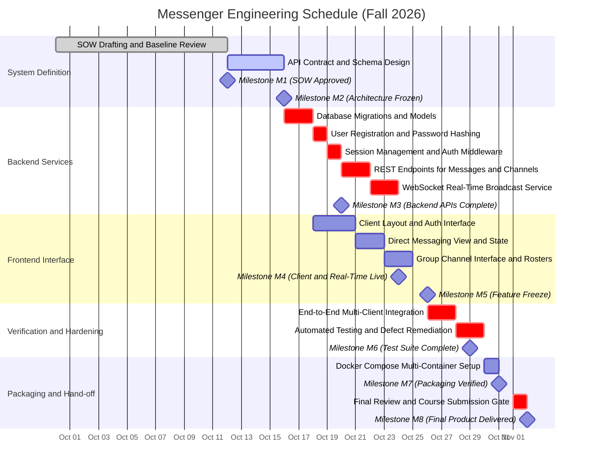

# Statement of Work

## Messenger: Real-Time Private and Group Communication Platform

> **Document status:** Final 
> **Course:** CPS 490: Capstone I (Fall 2026)
> **Assignment:** IA 02: Messenger: Statement of Work
> **Author:** Amar Sambe 
> **Assigned date:** September 30, 2026
> **Due date:** October 12, 2026
> **Final product delivery constraint:** November 2, 2026
> **Required repository path:** `docs/statement-of-work.md`
> **Version:** 1.0 
> **Last updated:** October 11, 2026 

---

## 1. Project Purpose and Objectives

### 1.1 Project Purpose
The purpose of the Messenger project is to design, implement, and deliver a reliable, self-hosted communication system. The client scenario specifies a communication application similar in general purpose to systems such as Discord, with an intentionally incomplete specification. Rather than attempting to clone every commercial Discord feature, this project defines a bounded, defensible software system that delivers core real-time text messaging primitives with high reliability and low operational complexity.

### 1.2 Major Objectives
The project is driven by four primary outcomes:

1. **Secure Access and Identity:** Provide user registration, password encryption, and session verification so only authorized users can access conversation records.
2. **Persistent Direct Messaging:** Enable registered users to exchange bidirectional private text messages with guaranteed chronological storage and fast delivery.
3. **Structured Group Channels:** Enable users to create, join, and participate in multi-user group channels with real-time broadcast and synchronized chat history.
4. **Reproducible Delivery and Packaging:** Produce a fully tested, containerized application with documentation that allows independent deployment and verification on clean hardware.

---

## 2. Stakeholders

| Stakeholder Group | Project Role | Relationship to the Proposed System|
|---|---|---|
| **Course Instructor / Client** | Sponsor and Evaluator | Defines baseline assignment expectations, evaluates architectural choices, verifies observable acceptance evidence, and enforces delivery constraints. |
| **Lead Developer (Student)** | Software Architect and Builder | Resolves specification ambiguities, implements backend and frontend systems, authors automated tests, and manages repository submissions. |
| **End Users (Members)** | System Consumers | Expect intuitive authentication, fast message transmission, persistent chat logs, clear channel navigation, and responsive connection status. |
| **Group Administrators** | Channel Operators | Require controls to create named discussion channels and inspect active member rosters. |
| **Evaluating System Administrator** | Deployment Verifier | Requires an unambiguous runbook and single-command startup (`docker compose up --build`) without undocumented local dependencies. |

---

## 3. Scope Boundary

### 3.1 In Scope
The following functionality and engineering tasks are in scope:

* **User Authentication and Sessions:**
  * Account registration with unique username checks and password validation.
  * Cryptographic password hashing (bcrypt or Argon2) with salt.
  * Token-based or session-based route protection and explicit session revocation (logout).
* **Private Direct Messaging (One-to-One):**
  * Direct bidirectional text exchange between any two registered users.
  * Persistent database storage with millisecond-precision timestamps.
  * Chronological retrieval of past direct conversations.
* **Group Messaging (Channels):**
  * Creation of named group channels with creator tracking.
  * Channel joining and active participant roster listing.
  * Multi-user message broadcasting to all active channel members simultaneously.
  * Persistent storage and chronological retrieval of group message history.
* **Web Client Interface:**
  * Responsive single-page web application compatible with modern browsers.
  * Dedicated views for authentication, channel switching, direct conversations, and active message feeds.
  * Real-time DOM updates for incoming messages without manual page reloads.
* **Packaging and Verification:**
  * Automated unit and integration test suites covering data models, APIs, and socket broadcast.
  * Containerized deployment configuration using Docker and Docker Compose.
  * Technical documentation covering setup, architecture, and verification results.

### 3.2 Out of Scope
The following items are explicitly excluded to prevent scope creep and ensure timely delivery:

* **Voice and Video Communication:** No WebRTC media streams, voice channels, audio compression, or video feeds.
* **Media and File Uploads:** No image hosting, attachment storage, audio uploads, or thumbnail generation; messaging is strictly plain text.
* **Granular Role Hierarchies:** No complex Discord-style permission matrices, custom role colors, or channel-by-channel override rules.
* **Ecosystem Extensions and Bots:** No external webhooks, bot automation frameworks, or third-party OAuth integrations (such as Google or Discord sign-in).
* **Native Desktop and Mobile Apps:** No native iOS, Android, Electron, or desktop binaries; client delivery is restricted to a modern web browser.
* **Zero-Knowledge Client Encryption:** Transport security is enforced via HTTPS/WSS, but client-side asymmetric key ratchets are excluded.
* **Distributed Multi-Server Clustering:** No multi-region distributed clustering, message brokers like Kafka, or database sharding.

---

## 4. Deliverables and Acceptance Criteria

Deliverables are reviewable engineering artifacts rather than activities like writing code or having meetings.

| ID | Deliverable Artifact | Description | Observable Acceptance Criteria |
|---|---|---|---|
| **D1** | Statement of Work | Formal planning document committed to version control. | Committed to `docs/statement-of-work.md`; satisfies all rubric items including scope, schedule, Gantt chart, and risks. |
| **D2** | Architecture Specification | System design and API contract document. | Committed to `docs/architecture.md`; specifies database schemas, REST endpoints, and WebSocket event payloads. |
| **D3** | Core Backend Engine | Server service handling business rules, auth, and persistence. | Source builds cleanly; schema migrations run without error; passes all authentication unit tests. |
| **D4** | Real-Time Messaging Gateway | WebSocket server managing connection pools and distribution. | Automated test verifies message sent by Client A is received by Client B within 200 ms under local execution. |
| **D5** | Web Client Application | Single-page browser client providing user interface. | User can register, authenticate, switch channels, and exchange messages dynamically without browser reloads. |
| **D6** | Automated Test Suite | Comprehensive unit and integration test suites. | Executing `npm test` or `pytest` runs cleanly with at least 80% line coverage and zero test failures. |
| **D7** | Deployment Package | Container definitions and setup runbook. | Executing `docker compose up --build` launches the full stack on a clean machine within 120 seconds. |
| **D8** | Final Verification Report | Audit log of verification tests and functional checks. | Committed to `docs/acceptance-report.md`; records passing verification for every in-scope requirement. |

---

## 5. Assumptions, Constraints, and Dependencies

### 5.1 Assumptions
Conditions currently accepted as operational baselines that require ongoing verification:

* **A1 (Single-Host Hosting):** Evaluation will take place on a single host machine or virtual container instance, eliminating the immediate need for distributed multi-server clustering.
* **A2 (Concurrency Target):** The prototype is sized to support up to 50 concurrent active users and 20 simultaneous messages per second without exceeding 500 ms delivery latency.
* **A3 (Browser Compatibility):** Evaluators and users interact with the system via standard evergreen web browsers (Chromium, Firefox, Safari) with modern WebSocket support.
* **A4 (Plain Text Formatting):** Message bodies consist of UTF-8 plain text up to 2,000 characters per message without markdown parsing.

### 5.2 Constraints
Fixed boundaries and mandatory restrictions that the project must respect:

* **C1 (Final Delivery Deadline):** The complete Messenger product and all evaluation artifacts must be fully ready and delivered no later than **November 2, 2026**.
* **C2 (Designated Repository Path):** This Statement of Work must reside at `docs/statement-of-work.md` in the course GitHub repository.
* **C3 (Individual Execution):** All architectural design, implementation, testing, and documentation must represent individual work under course academic integrity standards.
* **C4 (Defensible Product Scope):** The system must remain a defensible, bounded messaging utility rather than an uncontrolled clone of commercial software.

### 5.3 Dependencies
External technical tools, runtime dependencies, and review gates required for project completion:

* **D1 (Container Tooling):** Operational access to Docker Engine (v24+) and Docker Compose (v2+) on host execution environments.
* **D2 (Relational Database Support):** Stable container base images for PostgreSQL 16 or SQLite 3 with write-ahead logging support.
* **D3 (Course Review Feedback):** Timely instructor feedback on this Statement of Work baseline to guide downstream development stages.

---

## 6. Milestones, Schedule, and Gantt Chart

### 6.1 Schedule Strategy and Buffer
November 2, 2026 is a strict final deadline, not a planned completion date. Feature implementation concludes on **October 25, 2026**, leaving an eight-day buffer dedicated exclusively to integration testing, automated verification, defect correction, and packaging before final delivery.

### 6.2 Project Milestones

| Milestone ID | Target Date | Milestone Name | Observable Evidence of Completion |
|---|---|---|---|
| **M1** | Oct 12, 2026 | Statement of Work Approved | SOW committed to `docs/statement-of-work.md` satisfying all prompt criteria. |
| **M2** | Oct 16, 2026 | Architecture and Schemas Frozen | Data models and API contract documented; database migrations run cleanly. |
| **M3** | Oct 20, 2026 | Backend Auth and REST APIs Complete | Authentication and messaging REST endpoints operational with unit tests passing. |
| **M4** | Oct 24, 2026 | Real-Time Engine and Client UI Working | Real-time direct and channel messaging functional in browser client interface. |
| **M5** | Oct 26, 2026 | Feature Freeze | Core functionality fully implemented; scope locked against new feature additions. |
| **M6** | Oct 29, 2026 | Integration and Test Suite Complete | Automated test suite passes with at least 80% coverage; zero critical bugs open. |
| **M7** | Oct 31, 2026 | Packaging and Runbook Verification | Single-command launch (`docker compose up`) verified on clean test environment. |
| **M8** | Nov 02, 2026 | Final Product Delivery Milestone | Repository tagged `v1.0.0`; all artifacts present; course submission complete. |

### 6.3 Mermaid Gantt Chart

---

## 7. Acceptance Procedures

Acceptance is validated through observable, repeatable evidence rather than subjective impressions:

* **V1 (Identity and Access):** Unauthenticated requests to protected endpoints return HTTP 401; requests with valid credentials return HTTP 200 with an authorization token.
* **V2 (Direct Messaging):** User Alpha sends a private message to User Beta; User Beta receives and renders the message in real time without refreshing; refreshing the page loads the message in chronological order.
* **V3 (Group Messaging):** Users Alpha and Beta join Channel X; User Gamma does not join; User Alpha sends a channel message; User Beta sees the broadcast immediately; User Gamma receives zero network events.
* **V4 (Persistence Integrity):** Fifty sequential messages sent between two users retrieve in exact chronological order without dropped records following a server restart.
* **V5 (Cold Deployment):** Running `docker compose up --build` on a clean machine initializes all containers cleanly within 120 seconds with the web application fully accessible.

---

## 8. Risk Management

| Identified Risk | Severity | Likelihood | Mitigation Strategy |
|---|---|---|---|
| **WebSocket Connection Drops:** Intermittent network issues disconnect clients and lose message synchronization. | High | Medium | Implement client-side reconnection with exponential backoff and a timestamp-based delta fetch upon reconnecting. |
| **Scope Creep Toward Commercial Clones:** Adding non-essential features (voice, files, roles) threatens project completion. | High | High | Enforce Section 3.2 exclusions strictly; freeze features on October 26; reject all non-core additions. |
| **Integration Bottlenecks:** Delays in backend completion compress available time for client integration and testing. | High | Medium | Finalize data contracts early; use mock backend endpoints during initial client development. |
| **Deployment Inconsistencies:** Environment discrepancies between local workstations and evaluation systems. | Medium | Medium | Maintain containerized configurations in Docker Compose from the start; test on a secondary clean machine before delivery. |

---

## 9. Definition of Done

The Messenger project is complete when all of the following conditions are verifiably satisfied:

1. A new user can register, log in, and maintain an authenticated session.
2. Direct messaging between two users functions with persistent, chronological delivery.
3. Group channels can be created, joined, and used for real-time multi-user communication.
4. Reloading the browser or reconnecting restores message history accurately.
5. Automated test suites pass completely with a minimum of 80% coverage on core logic.
6. The entire system initializes from scratch using `docker compose up --build`.
7. The repository contains all required documentation in `docs/` without secrets, passwords, or temporary build files.

---

## 10. Approvals

| Role | Name | Signature / Approval | Date |
|---|---|---|---|
| **Student Engineer** | Amar Sambe | [Submitted] | October 11, 2026 |
| **Course Instructor / Evaluator** | Nick Stiffler | [Pending Review] | October 12, 2026 |
